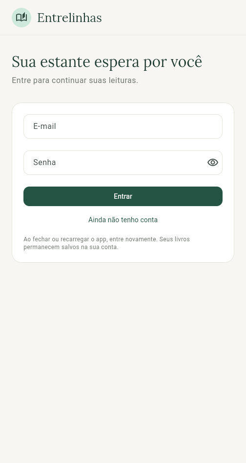
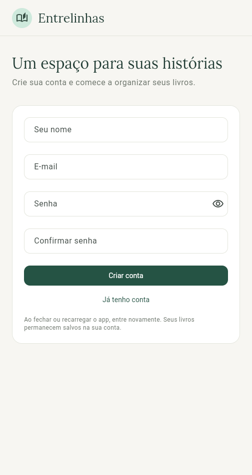
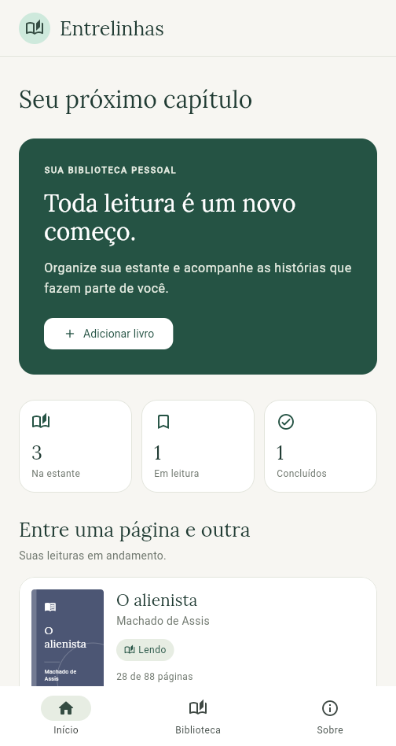
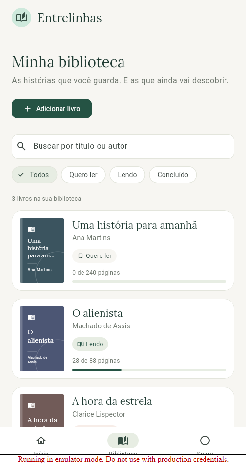
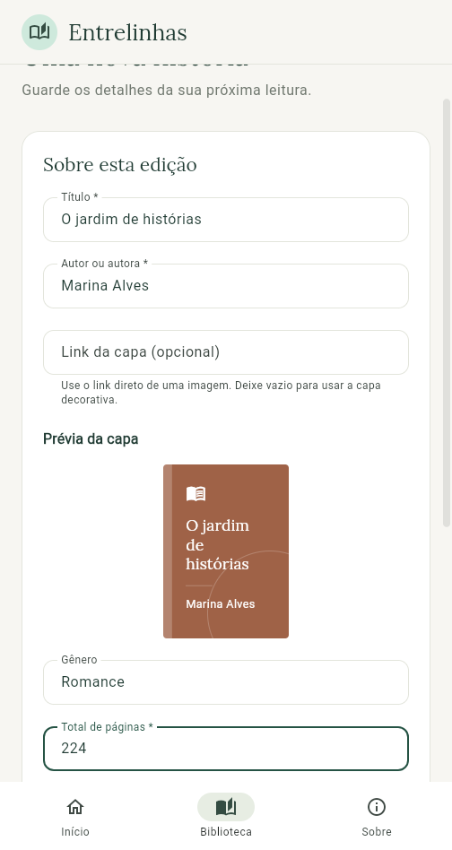
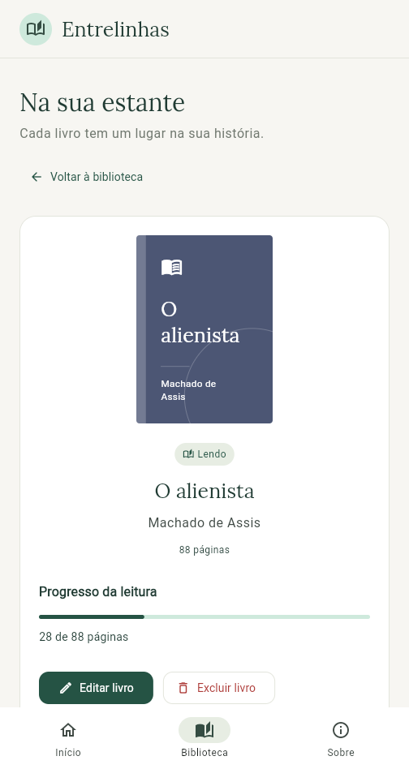
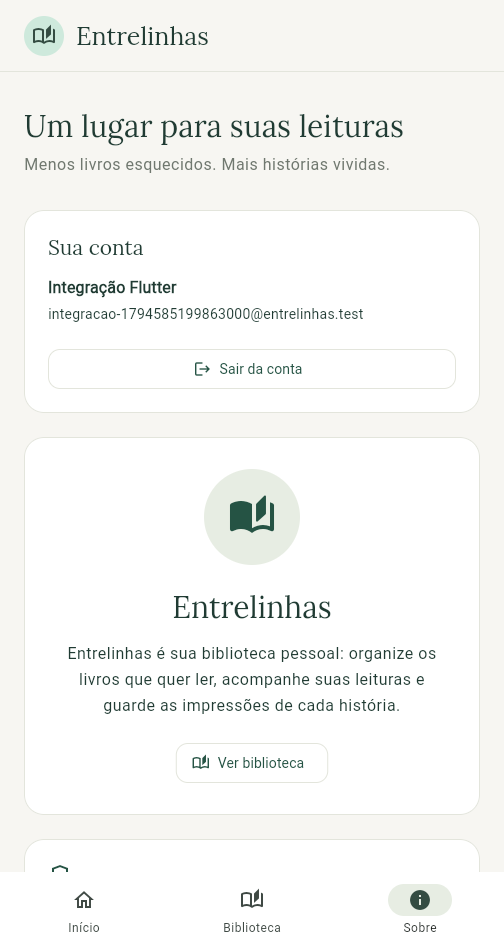

# Entrelinhas

Biblioteca pessoal em Flutter para organizar livros, acompanhar leituras e guardar anotações. O aplicativo consome a API Laravel do mesmo projeto integrado por HTTP.

**Aluno:** Vinicius Donini Santos Machado

**Back-end escolhido:** opção A — API Laravel, consumida com `http`.

**Repositório Flutter:** [Viniciusdonini/entrelinhas-flutter](https://github.com/Viniciusdonini/entrelinhas-flutter)

**Repositório da API:** [Viniciusdonini/entrelinhas-api](https://github.com/Viniciusdonini/entrelinhas-api)

## Projeto integrado e apresentação

O trabalho reúne Programação para Dispositivos Móveis, Programação Orientada a Objetos para Web e Paradigmas de Linguagem de Programação. A apresentação tem **cinco minutos**, na ordem **tema verbal → sistema → código**, sem slides e sem vídeo.

A próxima terça-feira, considerando as orientações recebidas em 13/11/2026, é **17/11/2026**. O prazo anterior do Moodle era **15/11/2026, às 23h59**. A mudança da apresentação não confirma uma prorrogação desse prazo.

Para Paradigmas, a entrega é em **texto online, contendo somente os links dos dois repositórios finais**, acessíveis ao professor. Consulte o [roteiro de apresentação](docs/roteiro_apresentacao.md).

## Funcionalidades

- Login e cadastro com a API Laravel; logout encerra a sessão.
- CRUD de livros com autoria, gênero, páginas, estado de leitura, notas e capa opcional por link HTTPS.
- Início com totais derivados dos registros da biblioteca do usuário.
- Busca por título/autoria e filtros por estado de leitura.
- Formulários validados e estados de carregamento, falha, lista vazia e registro inexistente.
- Tema próprio, componentes compartilhados e rotas nomeadas.
- API com quatro recursos: **livros, autores, gêneros e estantes**.

Os registros vêm da API. O aplicativo não insere uma lista fixa de livros. Dados de demonstração podem ser criados no banco pelo seeder da API, em ambiente local.

A capa é opcional: o banco guarda somente o endereço `coverUrl`. O componente `BookCover` mostra uma imagem de rede ou uma capa decorativa em caso de ausência/falha. Não há upload de imagens.

## Telas e rotas

São sete telas principais; o formulário de livro atende cadastro e edição.

| Tela | Função | Nome da rota | Caminho |
| --- | --- | --- | --- |
| Login | Entrar com e-mail e senha | `login` | `/entrar` |
| Cadastro | Criar uma conta | `register` | `/criar-conta` |
| Início | Resumo da biblioteca | `home` | `/` |
| Biblioteca | Listagem, busca e filtros | `books` | `/biblioteca` |
| Formulário | Cadastrar livro | `book-create` | `/biblioteca/novo` |
| Formulário | Editar livro | `book-edit` | `/biblioteca/:id/editar` |
| Detalhes | Consultar, editar e excluir | `book-details` | `/biblioteca/:id` |
| Sobre | Apresentação e funcionamento da sessão | `about` | `/sobre` |

A navegação usa `context.goNamed(...)`. Detalhes e edição recebem o ID na rota e consultam o service. Na web, o Flutter utiliza o formato com `#`, como `/#/biblioteca`.

## Camadas e responsabilidades

```text
lib/
├── main.dart
├── app.dart
├── core/
│   ├── constants/
│   ├── network/       # ApiClient, configuração e erros de HTTP
│   ├── routes/
│   ├── theme/
│   └── utils/
├── models/
├── repositories/     # contratos e implementações da API
├── services/         # regras de aplicação e sessão
├── screens/
└── widgets/
```

```text
Screen → Service → Repository → ApiClient → API Laravel
```

- **Model:** representa os dados e converte Map/JSON; não importa Flutter.
- **Screen:** coleta dados e exibe estados; não envia HTTP diretamente.
- **Service:** coordena regras e operações; não retorna widgets.
- **Repository:** encapsula endpoints e conversão dos dados recebidos.
- **ApiClient:** executa HTTP e encaminha o token da sessão.
- **Core:** centraliza tema, textos, rotas, configuração, validação e formatação; não importa Screens ou Services.
- **Widgets:** componentes reutilizados entre telas.

`LibraryBookService` implementa `BookService` e recebe `BookRepository`. `ApiBookRepository` conversa com a API pelo `ApiClient`. A autenticação segue a mesma separação com `AuthService`, `AuthRepository` e `ApiAuthRepository`.

A listagem faz requisições HTTP e é recarregada após operações e pela ação de atualizar. Isso não equivale a atualizações em tempo real enviadas pelo servidor.

Referência de organização da disciplina: [Guia Financeiro](https://github.com/matheushsouto/app-financas-flutter). A pasta de Repositories foi acrescentada para explicitar a separação exigida em Paradigmas.

## Executar a API

Use a pasta/repositório `entrelinhas-api` e siga seu README. Em uma instalação PHP **8.4.1 ou superior**, configurada com SQLite:

```shell
composer install
php -r "copy('.env.example', '.env');"
php artisan key:generate
```

Preencha `DEMO_NAME`, `DEMO_EMAIL` e `DEMO_PASSWORD` no `.env` local antes de criar a conta de demonstração. Depois:

```shell
php artisan migrate --seed
php artisan serve --host=127.0.0.1 --port=8000
```

O comando de cópia é para a primeira instalação: preserve um `.env` já configurado. A API fica em `http://localhost:8000/api`. O arquivo `rest.http` da API documenta autenticação e os quatro CRUDs; não exige frontend web ou Node.js.

## Executar o Flutter

Ambiente de referência: Flutter 3.47.1 e Dart 3.13.1. Mantenha o `pubspec.lock` para reproduzir as dependências. No VS Code, use as extensões Flutter/Dart.

```shell
flutter doctor
flutter pub get
```

Copie `config/api.example.json` para `config/api.local.json` e use:

```json
{
  "API_BASE_URL": "http://localhost:8000/api"
}
```

Com a API em execução:

```shell
flutter run -d chrome --dart-define-from-file=config/api.local.json
```

Para Android Emulator, crie `config/api.android.local.json` com `http://10.0.2.2:8000/api` e execute:

```shell
flutter devices
flutter run -d ID_DO_DISPOSITIVO --dart-define-from-file=config/api.android.local.json
```

`localhost` no emulador Android aponta para o próprio emulador; `10.0.2.2` alcança o computador hospedeiro. Em um dispositivo físico, use o IP local do computador e uma API acessível nessa rede. Em uma implantação remota, use HTTPS.

## Sessão, segurança e configuração

O login retorna um token Laravel Sanctum, enviado no cabeçalho `Authorization: Bearer ...`. O aplicativo mantém o token somente em memória: reiniciar/recarregar o app exige novo login. A biblioteca permanece no banco e volta a ser consultada pela mesma conta.

A API aplica autenticação e restringe os recursos ao usuário dono. A validação do formulário melhora a entrada de dados; o servidor também valida os campos e as associações. Nenhum token, senha de demonstração ou arquivo `.env` deve ser incluído no Git.

Os arquivos `config/*.local.json` são locais. A versão integrada utiliza Laravel; os resultados anteriores de Firestore não validam esse novo fluxo.

## Verificação

Execute depois de iniciar e preparar a API:

```shell
dart format .
flutter analyze
flutter test
```

Na API:

```shell
php artisan test
php vendor/bin/pint --test
composer check-platform-reqs
```

**Verificações de 13/11/2026:** `flutter test` aprovou **51 testes**; a análise Dart/Flutter não encontrou problemas; `dart format .` conferiu **53 arquivos**, sem alterações. A API aprovou **41 testes e 435 asserções**, além do Pint e da conferência de requisitos do Composer. A integração Flutter/Chrome aprovou **dois testes contra a API real**, cobrindo CRUD pelo repository/service e a captura das sete telas.

O [registro de verificação](docs/verificacao.md) descreve os comandos, a execução no Windows e os limites desses resultados. Os testes antigos de Firestore são históricos e não foram usados para aprovar esta versão.

## Prints

As sete capturas abaixo foram geradas em **13/11/2026**, com autenticação e dados recebidos da API Laravel real. Os exemplos pertencem ao teste de integração; não são uma lista fixa carregada pela aplicação.

| Login | Cadastro de conta |
| --- | --- |
|  |  |

| Início | Biblioteca |
| --- | --- |
|  |  |

| Formulário | Detalhes |
| --- | --- |
|  |  |



## Estudo e entrega

Leia o [guia de estudo](docs/guia_de_estudo.md), pratique o [roteiro de cinco minutos](docs/roteiro_apresentacao.md) e confira o [registro de verificação](docs/verificacao.md). Não é necessário produzir vídeo ou slides.

Antes da entrega, os dois repositórios devem conter a mesma versão demonstrada, estar acessíveis e ter instruções reproduzíveis. Para Paradigmas, envie somente os dois links no campo de texto online do Moodle.

A fonte Lora utiliza a licença [SIL Open Font License](assets/fonts/OFL.txt).
